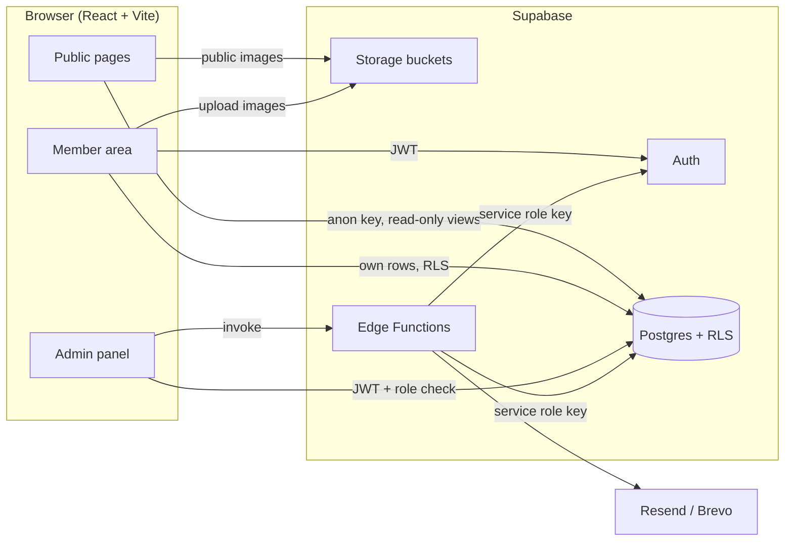
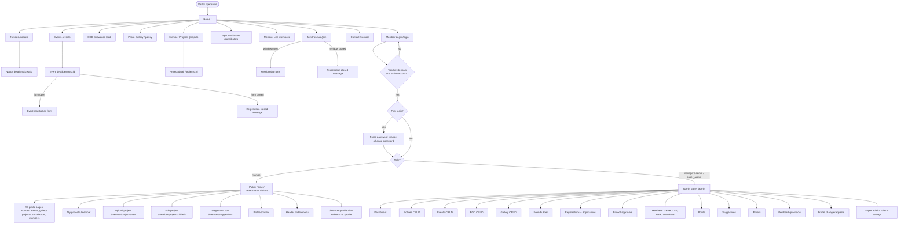
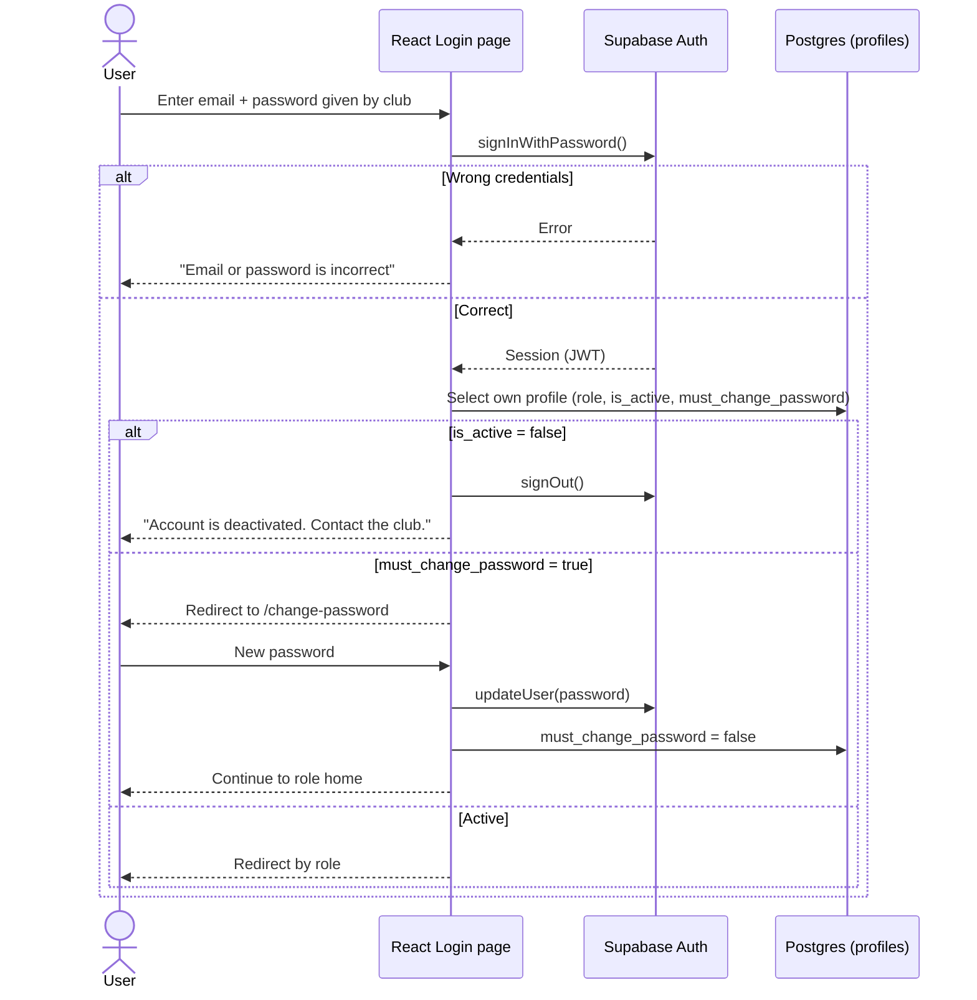
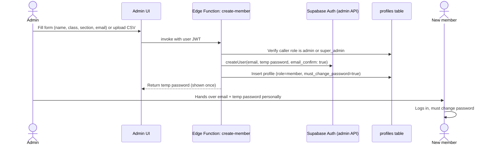
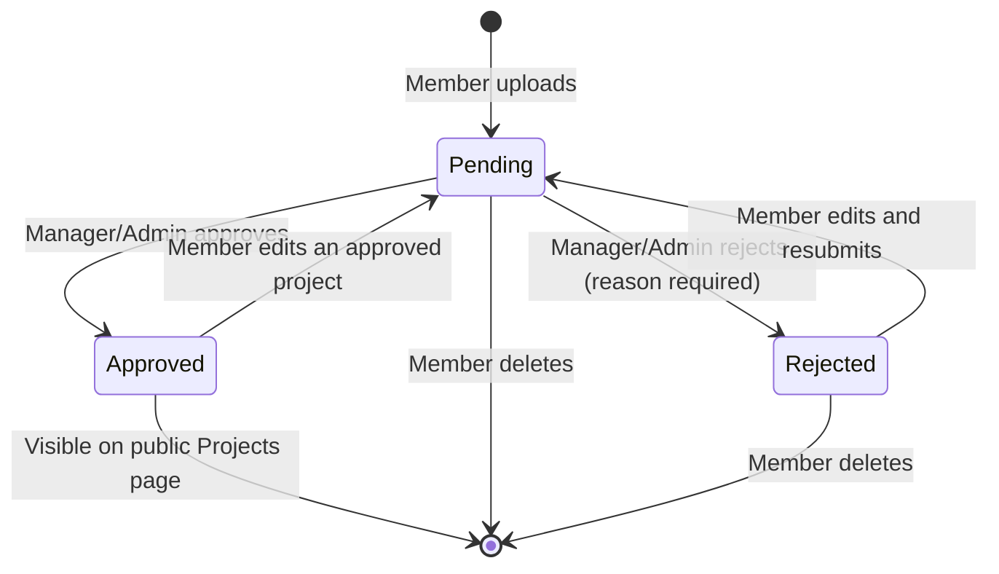
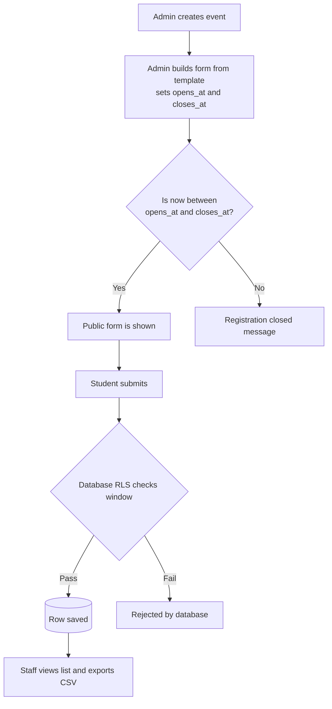
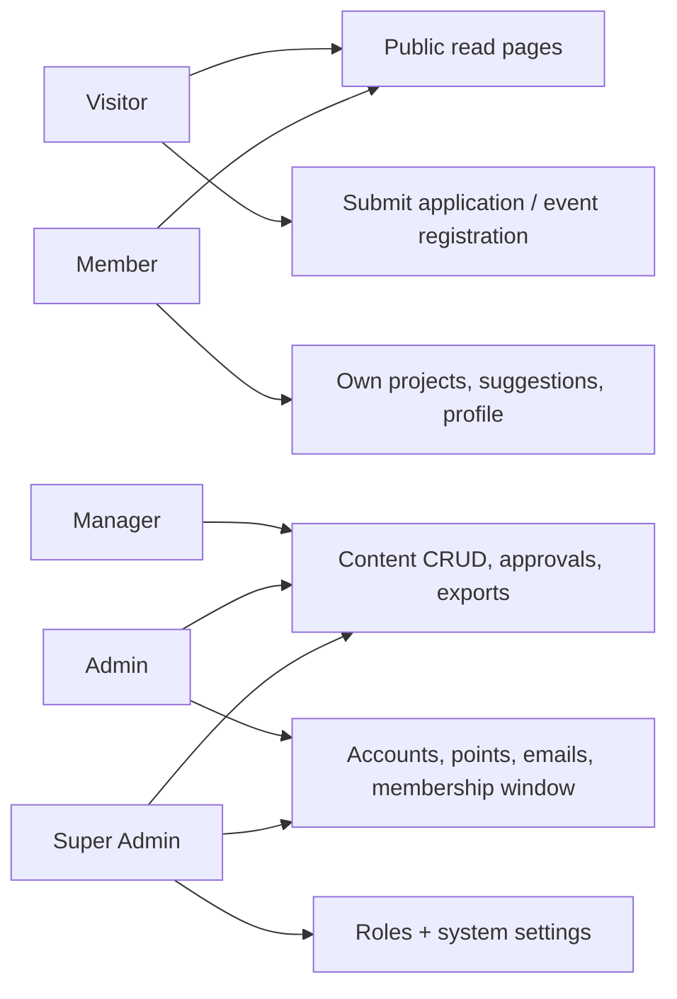

# ARCHITECTURE.md: VAC Tech Jr Website

How the system is built, how data flows, and the rules anyone (human or AI) must follow while building it.

Diagrams use **Mermaid**. They render on GitHub, GitLab, VS Code (Markdown Preview Mermaid extension) and most MD viewers.

---

## 1. Tech stack

| Layer        | Tool                      | Notes                                                                                                            |
| ------------ | ------------------------- | ---------------------------------------------------------------------------------------------------------------- |
| Build tool   | **Vite 8** (Rolldown)     | Vite bundles the app; vendor code is split in `vite.config.js`                                                   |
| UI           | **React 19**              | Function components and hooks only                                                                               |
| Styling      | **Tailwind CSS v4**       | CSS-first: the tokens live in `src/index.css` under `@theme inline` (see `DESIGN.md`)                            |
| Routing      | **React Router v6**       | Public, member and admin route groups                                                                            |
| Server state | **TanStack Query**        | Fetching, caching, loading and error states                                                                      |
| Forms        | **React Hook Form + Zod** | Validation on every form                                                                                         |
| Backend      | **Supabase**              | Postgres, Auth, Storage, Row Level Security, Edge Functions                                                      |
| Email        | **Resend or Brevo**       | Called only from an Edge Function                                                                                |
| CSV          | **PapaParse**             | Import and export                                                                                                |
| Icons        | **lucide-react**          | One icon set only                                                                                                |
| Dates        | **date-fns**              | Small and tree-shakable                                                                                          |
| Toasts       | **sonner**                | One library only; `<Toaster>` lives in `App.jsx`                                                                 |
| Hosting      | **Cloudflare Pages**      | Preset React/Vite, build `npm run build`, output `dist`; auto-deploy from GitHub `main`. `vercel.json` is unused |

## 2. System overview



**Principle:** the browser only ever holds the **anon key** and the user's own session. Anything that needs elevated power (create accounts, reset passwords, send email) runs in an **Edge Function**.

## 3. Website flow (full sitemap)



## 4. Login flow (detailed)



## 5. Account creation flow (no self sign-up)



## 6. Project upload and approval flow



## 7. Registration flow (membership and events)



## 8. Role access map



## 9. Folder and file structure

```
vac-tech-jr/
├── docs/
│   ├── PRD.md
│   ├── ARCHITECTURE.md
│   ├── DESIGN.md
│   ├── PHASES.md
│   ├── TESTING.md              # the test plan for the testing team, Phase 1 to Phase 8
│   ├── HANDOVER.md             # plain-language guide for the next committee
│   ├── OWNER-ACTIONS.md        # migrations, secrets and deploys only the owner can do
│   └── MEMORY.md               # current state and resume point — read last
├── public/
│   └── favicon.svg
├── supabase/
│   ├── migrations/            # ALL SQL lives here, numbered, applied in order
│   │   ├── 0001_profiles_roles.sql
│   │   ├── 0002_content_tables.sql
│   │   ├── 0003_profiles_protection.sql
│   │   ├── 0004_showcase_tables.sql
│   │   ├── 0005_registrations.sql
│   │   ├── 0006_projects_and_profile_changes.sql
│   │   └── 0007_points_suggestions_email.sql
│   ├── functions/             # the ONLY place the service role key is used
│   │   ├── _shared/           # auth, cors, respond, email, password, rateLimit, members
│   │   ├── create-member/index.ts
│   │   ├── bulk-create-members/index.ts
│   │   ├── reset-password/index.ts
│   │   ├── set-account-status/index.ts
│   │   ├── apply-profile-change/index.ts
│   │   ├── change-role/index.ts
│   │   └── send-email/index.ts
│   └── seed.sql               # fake data for development only
├── src/
│   ├── main.jsx
│   ├── App.jsx
│   ├── index.css              # Tailwind layers + CSS variables (the token source)
│   ├── lib/
│   │   ├── supabaseClient.js  # the ONLY place the client is created
│   │   ├── queryClient.js
│   │   ├── functions.js       # invokeFunction(): calls an Edge Function, unwraps its message
│   │   ├── constants.js       # roles, statuses, routes
│   │   └── utils.js           # formatDate, formatNepalDateTime, csvCell, initials, cn()
│   ├── routes/
│   │   ├── index.jsx          # route table + role guards
│   │   ├── ProtectedRoute.jsx # role-aware guard
│   │   └── PublicLayout / AdminLayout
│   ├── context/
│   │   ├── AuthContext.jsx    # session, profile, role, signIn, signOut
│   │   └── useAuth.js
│   ├── components/
│   │   ├── ui/                # Button, Input, Textarea, Card, Modal, DataTable, Badge, Spinner, EmptyState, ErrorState
│   │   ├── layout/            # Navbar, Footer, Sidebar, PageHeader, SectionHeading, Section, ProfileMenu
│   │   └── shared/            # IntroAnimation, HeroVisual, ImageUpload, ConfirmDialog, CsvExportButton, DynamicForm, ErrorBoundary
│   ├── features/              # one folder per domain
│   │   ├── auth/              # LoginPage, ChangePasswordPage, PasswordForm, api.js, hooks.js
│   │   ├── notices/           # components, api.js, hooks.js, schema.js
│   │   ├── events/
│   │   ├── bod/
│   │   ├── gallery/
│   │   ├── projects/
│   │   ├── registrations/     # membership + event forms, form builder
│   │   ├── members/           # accounts, profile change requests, own profile, the public list
│   │   ├── accounts/          # change-role only (super admin)
│   │   ├── points/
│   │   ├── suggestions/
│   │   ├── emails/
│   │   ├── settings/
│   │   ├── leaderboard/
│   │   ├── dashboard/
│   │   └── storage/           # upload, shrink, remove, storageLocation
│   ├── pages/
│   │   ├── public/            # Home, Notices, Events, Bod, Gallery, Projects, Contributors, Members, Join, Contact
│   │   ├── member/            # Dashboard (My projects), UploadProject, EditProject, Suggestions, Profile
│   │   ├── admin/             # Dashboard, NoticesAdmin, …, Roles, Settings
│   │   └── NotFound.jsx
│   └── hooks/                 # shared hooks only
├── .env.example               # names of variables, no real values
├── .gitignore
├── eslint.config.js
├── vite.config.js             # plugins + vendor chunk groups
├── package.json
├── vercel.json                # unused leftover from the first plan
└── README.md                  # setup, deploy, common tasks, account ownership
```

**Feature folder rule:** each `features/<name>/` owns its `api.js` (Supabase calls), `hooks.js` (TanStack Query wrappers), `schema.js` (Zod) and its own components. Pages only compose features.

## 10. Data layer

### Tables (all have RLS enabled)

`profiles`, `notices`, `events`, `bod_members`, `gallery_photos`, `projects`, `registration_forms`, `event_registrations`, `membership_windows`, `membership_applications`, `points_log`, `suggestions`, `settings`, `email_log`, `profile_change_requests`

`profiles` also carries `email` and `phone`. Both are **private**: they never appear in a public view and a member can only change them through `profile_change_requests`.

`settings` is the opposite: it is a public key/value store (site name, contact details, links), readable by everyone. Nothing private may be written there.

### Public and staff views (the only way personal data leaves the database)

| View                | Read by                            | Exposes                                                              |
| ------------------- | ---------------------------------- | -------------------------------------------------------------------- |
| `public_members`    | everyone                           | full_name, class, section, github_url, avatar_url (active members)   |
| `public_projects`   | everyone                           | project fields (approved only) + owner name, class, section, GitHub  |
| `leaderboard`       | everyone                           | member name, class, total points (only members who have scored)      |
| `staff_projects`    | staff (role-gated inside the view) | every project + owner name and class, for the review queue           |
| `staff_suggestions` | staff (role-gated inside the view) | suggestion id, message, is_read, read_at, created_at — **no author** |

> These views are the hard boundary for privacy: they must never select `email`, `phone` or
> `author_id`. The two `staff_*` views are plain views (they run as their owner), so the role check in
> their `where` clause _is_ the security boundary — do not add `security_invoker` to them
> (`0004`'s header comment explains why).

### Storage buckets

| Bucket           | Read   | Write                                  |
| ---------------- | ------ | -------------------------------------- |
| `gallery`        | public | staff                                  |
| `project-images` | public | owner (own folder `userId/`) and staff |
| `avatars`        | public | owner and staff                        |
| `bod-photos`     | public | staff                                  |

Limits: images only (jpeg, png, webp), max 2 MB per file enforced in bucket settings and in the UI.

## 11. Security rules (non-negotiable)

1. **RLS is enabled on every table.** A new table without policies is a bug.
2. Role checks use a database helper, e.g. `public.current_role()`, never data sent by the client.
3. `profiles.role`, `is_active` and points cannot be updated by the row owner (column-level protection or a trigger).
4. Registration inserts are allowed only when `now()` is inside the window (policy-level check).
5. The **service role key** exists only in Edge Function secrets. It must never appear in `src/`, `.env` files committed to Git, or any `VITE_` variable.
6. Only these variables are allowed in the frontend: `VITE_SUPABASE_URL`, `VITE_SUPABASE_ANON_KEY`.
7. `.env` is in `.gitignore`. `.env.example` lists names only.
8. Public pages read from **views**, not raw tables, whenever personal data is involved.
9. Test every table: logged out, as a member, as manager, as admin, as super admin.
10. A member may never write `email`, `phone`, `full_name`, `class` or `section` on their own row. The `profiles_protect_columns` trigger blocks it; those values change only through `profile_change_requests` reviewed by an Admin or Super Admin.
11. `profiles.email` is written only by the `apply-profile-change` Edge Function (service role). A member changing their email also needs the change reflected in Supabase Auth, which the browser cannot do.
12. `settings` is **publicly readable**. Never store a private value in it: no API keys, no secrets, no personal email address or phone number. Private values go in Edge Function secrets, or in a table with no public read policy.
13. A member may change their own `github_url`, `avatar_url` and password flag, but not `full_name`, `class` or `section` — migration `0003` enforces that in the `profiles_protect_columns` trigger.
14. **`points_log` is append-only and admin-only.** Admin and Super Admin may `insert` (with `given_by = auth.uid()`, a non-zero amount and a reason). There is no update policy and no delete policy for anyone — a correction is a new row. The public ranking reads the `leaderboard` view; no member can write or mutate points.
15. **A suggestion's author is never readable.** `author_id` exists for the daily rate limit (10 per author per 24 h, enforced by a trigger) and is revoked at column level for every client role — `anon` and `authenticated` may select only id, message, is_read, read_at and created_at. Staff read the `staff_suggestions` view, which has no author column at all. A trigger freezes the message, so "mark read" can never become "edit".
16. **`email_log` is written by the service role only.** No insert, update or delete policy exists for any client role; admins read the history. The recipient addresses themselves are never stored — only the group name and how many people it reached.
17. **Outbound email is escaped at the boundary** (`_shared/email.ts`): subject and body are plain text, control characters are stripped, markup characters are escaped, one dispatch is capped at 100 recipients, and every send is logged with its result.
18. **Every Edge Function re-checks the caller.** It verifies the JWT, reads the role from `profiles` (never from the request body), refuses a deactivated account, applies a per-caller rate limit, and validates its body with Zod before touching the database.
19. **`change-role` can never touch a super admin** — not create, not promote, not demote — and refuses a self-change. The institution's account is handed over by hand, in Supabase.
20. **A hidden link is never the only defence.** Each admin route carries the same role check as its sidebar entry (`routes/index.jsx` + `AdminLayout.jsx`).

## 12. Error handling conventions

| Situation                   | What to do                                                            |
| --------------------------- | --------------------------------------------------------------------- |
| Any Supabase call           | Check `error`; throw it so TanStack Query handles it. Never ignore it |
| Page-level data failure     | Show an `ErrorState` component with a Retry button                    |
| Loading                     | Skeleton or `Spinner`, never a blank screen                           |
| Empty list                  | `EmptyState` with a short friendly message                            |
| Form validation             | Zod schema + inline field messages                                    |
| Mutation success or failure | Toast message (short, plain language)                                 |
| Auth expiry                 | On 401, sign out and redirect to `/login` with a message              |
| Unexpected crash            | A top-level React **Error Boundary** with a friendly fallback         |
| Unknown route               | `NotFound` page                                                       |
| Window closed (forms)       | Show "Registration closed", not an error                              |

Rules:

- Error messages for users are **plain language**. Never show raw database errors.
- Log technical detail with `console.error` in development only.
- Never `catch` and silently continue.

## 13. Libraries: use and avoid

**Approved list:** everything in section 1. Adding anything else needs a line in `MEMORY.md` explaining why.

**Avoid (and why)**

| Avoid                                       | Reason                                             | Use instead                             |
| ------------------------------------------- | -------------------------------------------------- | --------------------------------------- |
| Redux, MobX, Zustand for server data        | Overkill, duplicates TanStack Query                | TanStack Query + React Context for auth |
| Axios                                       | Not needed with the Supabase client                | Supabase client                         |
| Firebase or a custom Express server         | Splits the stack, adds maintenance                 | Supabase only                           |
| Material UI, Ant Design, Chakra             | Heavy, clashes with Tailwind and the design tokens | Own `components/ui`                     |
| Moment.js                                   | Large and deprecated                               | date-fns                                |
| Formik                                      | Heavier than needed                                | React Hook Form                         |
| `localStorage` for auth tokens by hand      | Supabase already manages the session               | Supabase session                        |
| jQuery, Bootstrap                           | Conflicts with React and Tailwind                  | Tailwind                                |
| Random unmaintained packages                | Future committees cannot maintain them             | Prefer widely used libraries            |
| Inline CSS and `!important`                 | Breaks theming                                     | Tailwind classes and tokens             |
| `dangerouslySetInnerHTML` with user content | XSS risk                                           | Render as plain text                    |

## 14. Coding standards

- Function components, hooks, named exports for components (default export only for pages if routing needs it).
- File names: `PascalCase.jsx` for components, `camelCase.js` for logic.
- One component per file. Keep files under about 250 lines; split when they grow.
- No Supabase calls inside components. Always go through `features/<name>/api.js` and `hooks.js`.
- Every list and detail page handles: loading, error, empty, success.
- Mobile first. Test at 360px, 768px and 1280px.
- Use design tokens only. No hard-coded colors (see `DESIGN.md`).
- Commit messages: `feat: ...`, `fix: ...`, `docs: ...`, `chore: ...`.
- Branch per phase: `phase-1-foundation`, etc. Merge to `main` when the phase passes its checklist.

## 15. AI boundaries (rules for any AI assistant working on this repo)

**Before doing anything**

1. Read `docs/MEMORY.md` first, then `PHASES.md` for the current phase, then this file.
2. Work on **one task at a time** from the current phase. Do not jump ahead.

**The AI may**

- Create and edit files inside `src/`, `supabase/migrations/`, `supabase/functions/`, `docs/`.
- Propose new migrations as **new numbered files**.
- Suggest improvements, but must note them in `MEMORY.md` as suggestions, not silently implement them.

**The AI must not**

- Install new libraries not in the approved list without asking.
- Change the folder structure, stack, role names or decisions in `PRD.md` without asking.
- Edit old migration files that have already been applied. Add a new one.
- Put any secret, service role key or real password in code, docs or examples.
- Disable, loosen or "temporarily" remove RLS policies.
- Create a public sign-up page or enable email sign-ups.
- Use real student data in seed files or examples.
- Delete files or data without being told to.
- Invent database columns, routes or features that are not in `PRD.md` / `PHASES.md`.
- Leave `TODO` comments without adding them to `MEMORY.md`.

**The AI must always**

- Follow `DESIGN.md` tokens for any UI.
- Handle loading, error and empty states.
- Validate input with Zod and rely on RLS for real enforcement.
- Say clearly when it is unsure instead of guessing.
- **Update `docs/MEMORY.md` at the end of every working session** (see that file for the format).

## 16. Environment and deployment

| Item                                          | Where                                                                                                                                   |
| --------------------------------------------- | --------------------------------------------------------------------------------------------------------------------------------------- |
| `VITE_SUPABASE_URL`, `VITE_SUPABASE_ANON_KEY` | Cloudflare Pages env vars + local `.env`                                                                                                |
| `NODE_VERSION`                                | Cloudflare Pages env var (`22`)                                                                                                         |
| `SUPABASE_SERVICE_ROLE_KEY`                   | Supabase Edge Function secrets only                                                                                                     |
| `RESEND_API_KEY` (or `BREVO_API_KEY`)         | Supabase Edge Function secrets only                                                                                                     |
| `SENDER_EMAIL`                                | Supabase Edge Function secrets only — the verified sender address                                                                       |
| `EMAIL_PROVIDER`                              | Supabase Edge Function secrets only — optional; `resend` is the default, `brevo` swaps the adapter                                      |
| SPA fallback                                  | Cloudflare Pages serves `index.html` for unknown routes (Vite SPA preset). `vercel.json` is left over from the first plan and is unused |
| Repo                                          | https://github.com/officialvactechjr/Website, branch `main`                                                                             |

Deployment: push to `main` → Cloudflare Pages builds and deploys. Database changes: apply migrations with the Supabase CLI or paste into the SQL editor, in numbered order. Supabase's **Site URL** must match the Cloudflare address (see `MEMORY.md` section 6).

## 17. Handover essentials

- All accounts (GitHub, Supabase, Cloudflare, email provider) under an **official club email**, with the Super Admin as co-owner. The ownership map is in `README.md`.
- `README.md` explains: run locally, deploy, add a notice, create a member, change roles, send an email, give points.
- `docs/HANDOVER.md` is the same thing in plain language, written for a committee with no programmer in it.
- `docs/OWNER-ACTIONS.md` is the ordered list of everything that needs a human: migrations, secrets, deploys, the email provider.
- Keep `MEMORY.md` current: it is the project's living history.
