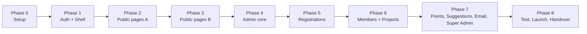

# PHASES.md: Build Plan by Phase and Page

Work is split into **phases and pages**, not weeks. Finish a phase's checklist before starting the next. Mark items with `[x]` here and mirror progress in `MEMORY.md`.

> **TESTING IS DEFERRED (owner decision, 2026-10-19).** The per-phase console tests are no longer run
> as each phase closes. A testing team runs **everything, from Phase 1 to the last phase, in one
> pass** at the end. The whole plan lives in **`docs/TESTING.md`**, and every new phase adds its tests
> there. A ticked box below therefore means **built and reviewed**, never **verified**.
>
> **Build complete (2026-10-20):** Phases 0-8 are all either **built** or explicitly left to the
> owner/testing team, and the boxes below say which is which. Nothing has been verified against the
> live database since Phase 4 — the migration and deploy steps in `docs/OWNER-ACTIONS.md` come first.

Requirement IDs (PUB-01, ADM-05, etc.) come from `PRD.md`.

> The public site can go live after **Phase 3**, while the admin and member systems are still being built.

---

## Phase 0: Project Setup

**Goal:** an empty app that runs, deploys and connects to Supabase.

- [x] Create official club GitHub, Supabase and Cloudflare Pages accounts
- [x] `npm create vite@latest` (React), install approved libraries
- [x] Configure Tailwind with tokens from `DESIGN.md`
- [x] Create folder structure from `ARCHITECTURE.md` section 9
- [x] `lib/supabaseClient.js`, `.env.example`, `.gitignore`
- [x] ESLint + Prettier
- [x] SPA fallback; first deploy of a blank page (Cloudflare Pages; `vercel.json` is unused)
- [x] Copy `docs/` files into the repo

**Done when:** the deployed URL shows a placeholder page and the Supabase client connects.

---

## Phase 1: Auth, Roles and App Shell

**Goal:** login works, roles work, layouts exist.

**Database (migration 0001)**

- [x] `profiles` table, role enum, `is_active`, `must_change_password`
- [x] Helper function `current_role()`
- [x] RLS on `profiles`; protect role/active columns
- [x] Disable email sign-ups in Supabase Auth settings
- [x] Create the first Super Admin manually in the dashboard
- [x] Migration `0001` applied to the live Supabase project

**Pages and components**

- [x] `/login`: Login page (email + password only)
- [x] `/change-password`: forced password change page
- [x] `AuthContext` (session, profile, role)
- [x] `ProtectedRoute` with role checks
- [x] `PublicLayout` (Navbar + Footer), `AdminLayout` (sidebar)
- [x] `NotFound`, Error Boundary
- [x] Base `components/ui`: Button, Input, Card, Modal, Badge, Spinner, EmptyState, ErrorState
- [x] Dark/light theme toggle — **removed**: the UI is dark-only

**Done when:** a manually created user can log in, is forced to change the password, lands on the right placeholder area by role, and a deactivated user is blocked.

> Done. Verified against the live project: a member cannot change their own `role`, name, class or
> section and cannot write notices, while an admin can (see `MEMORY.md` section 6 item 13).
> `MemberLayout` was dropped in step 2.2 — member pages live inside the public layout.

---

## Phase 2: Public Pages, Part A (content basics)

**Goal:** the first real content people see, behind the intro animation.

**Shell (2.1-2.2)**

- [x] Intro animation ported to `src/components/shared/IntroAnimation.jsx` (step 2.1)
- [x] Header switches by session: profile button + menu when logged in, "Member login" + "Join the club" when logged out
- [x] Footer: 3 columns, every public page reachable
- [x] `/profile` (MEM-07): password change only for now — the change requests arrive in Phase 6
- [x] Members land on `/` after login; staff still land on `/admin`

**Database (migration 0002)**

- [x] `notices`, `events`, `settings` tables with RLS (public read gated by RLS, staff write) — applied, plus `seed.sql`
- [x] `0002`'s read policies keep drafts in: notices only once `published_at <= now()`, events only when `status` is `published` or `cancelled`
- [x] `0003_profiles_protection.sql`: only an admin may change `full_name`, `class` or `section`

**Pages**

- [x] `/`: **Home** (PUB-01): hero with `HeroVisual` and "View about" / "Join the club", What the club does (`#about`), Notices, Events, Explore links, Join card
- [x] `/notices`: **Notices list** (PUB-02), pinned first
- [x] `/notices/:id`: **Notice detail**
- [x] `/events`: **Events list** (PUB-03): upcoming and archive tabs
- [x] `/events/:id`: **Event detail** (registration area added in Phase 5)
- [x] `/contact`: **Contact** (PUB-11)
- [x] `/join`: **closed state** for now (PUB-09 form is Phase 5)
- [x] Route-level `React.lazy()` + `Suspense` so the first bundle stays small

**Close-out (2.5)**

- [x] `DESIGN.md` final pass: tokens, components, imagery, motion, and the accessibility checklist turned into a checked record
- [x] **Light-theme contrast check DONE** (2026-10-19): four light status colours darkened to pass WCAG AA as text
- [x] Second review pass: the input focus ring restored, touch-target numbers corrected, the duplicated token block replaced with a pointer

> Home's Projects / Top contributors / BOD previews are the **first Phase 3 tasks** — their tables arrive with migration 0004.

> **Step 2.5 is done** (2026-10-19): the `DESIGN.md` pass and the light-theme contrast check are
> complete, and four light-theme status colours were darkened to pass WCAG AA. **Phase 2 is closed.**
> The public site can go live here; Home's Projects / Top contributors / BOD previews are the first
> Phase 3 tasks.

**Done when:** all six pages work on mobile with loading, error and empty states.

---

## Phase 3: Public Pages, Part B (people and showcase)

**Database (migration 0004)**

- [x] `bod_members`, `gallery_photos`, `projects`, `points_log` tables
- [x] Views: `public_members`, `public_projects`, `leaderboard`
- [x] Storage buckets: `gallery`, `bod-photos`, `project-images`, `avatars`

**Pages**

- [x] `/bod`: **BOD Showcase** (PUB-04)
- [x] `/gallery`: **Photo Gallery** (PUB-05) with lightbox
- [x] `/projects`: **Member Projects** (PUB-06), approved only
- [x] `/projects/:id`: **Project detail**
- [x] `/contributors`: **Top Contributors** (PUB-07)
- [x] `/members`: **Member List** (PUB-08)

**Home previews (deferred here from step 2.3)**

- [x] Projects preview (`ProjectList limit={2}`)
- [x] Top contributors preview (`LeaderboardList limit={5}`)
- [x] BOD preview (`BodGrid limit={4}`)

**Done when:** public site is complete with seed data. **Safe point to launch the public site.**

> Built 2026-10-19 and **re-verified on 2026-10-20**: all six routes are in
> `src/routes/index.jsx`, every page carries loading / error / empty states, the gallery
> lightbox handles Esc, arrow keys and the single-photo case, and the three Home previews
> are in `src/pages/public/Home.jsx`. **Phase 3 is closed.**

---

## Phase 4: Admin Panel Core

**Goal:** staff can manage content without touching the database.

**Pages**

- [x] `/admin`: **Dashboard** (ADM-15): counts, recent activity
- [x] `/admin/notices`: **Notices** CRUD (ADM-01)
- [x] `/admin/events`: **Events** CRUD (ADM-02)
- [x] `/admin/bod`: **BOD** CRUD (ADM-03)
- [x] `/admin/gallery`: **Gallery** CRUD with multi-image upload (ADM-04)

**Shared pieces**

- [x] Reusable `DataTable` (search, sort, pagination)
- [x] Reusable `ImageUpload` (resize, size limit, preview)
- [x] `ConfirmDialog` for deletes

**Done when:** a Manager can add, edit and delete content in all four areas and it appears publicly.

> Closed 2026-10-19. The owner's console tests passed (storage permissions, `/admin` gates, notice CRUD
> from the UI), and the seven review findings were fixed first.

---

## Phase 5: Registrations

**Database (migration 0005)**

- [x] `membership_windows`, `membership_applications`, `registration_forms`, `event_registrations`
- [x] RLS: public insert only inside the open window

**Pages**

- [x] `/join`: **Membership form** (PUB-09) with consent checkbox, auto closed message
- [x] Event detail: **Event registration form** (PUB-10) rendered from JSON via `DynamicForm`
- [x] `/admin/registration-forms`: **Form builder** (ADM-05): template questions, toggle on/off, open and close time
- [x] `/admin/registrations`: **Event registrations** list and CSV export (ADM-06)
- [x] `/admin/applications`: **Membership applications** list, status, CSV export (ADM-06)
- [x] `/admin/settings/membership`: **Open or close membership window** (ADM-14)

**Done when:** forms accept entries only inside the window (verified by trying to bypass the UI) and staff can export.

> **Status: BUILT, TESTS DEFERRED** (2026-10-19). Every console test from Phase 1 to Phase 5 is now
> collected in `docs/TESTING.md` and will be run by the testing team in one pass. Phase 5 is **not**
> tested yet — do not treat the checkboxes above as proof it works.

---

## Phase 6: Members and Projects

**Database (migration 0006 + 0007)**

- [x] RLS for `projects` (owner CRUD, staff review), status flow, `review_note` — in `0006_projects_and_profile_changes.sql`
- [x] `profile_change_requests` table + RLS
- [x] `profiles.email` + `profiles.phone`, and protection so a member cannot write `email`, `phone`, `full_name`, `class` or `section` directly
- [x] Storage: a member writes only inside their own `{userId}/` folder

**Edge Functions**

- [x] `create-member`, `bulk-create-members`, `reset-password`
- [x] `apply-profile-change` — applies an approved email change with the service role key
- [x] `set-account-status`, `change-role` — deactivate/reactivate, and promote or demote

**Admin pages**

- [x] `/admin/members`: **Members list**: create one (ADM-08), CSV import (ADM-09), reset password, deactivate or reactivate (ADM-10)
- [x] `/admin/approvals`: **Project approvals** (ADM-07) with reject reason
- [x] `/admin/profile-changes`: **Profile change requests** (ADM-16): approve or reject with a note _(was `/admin/profile-requests`)_

**Member pages**

- [x] `/member`: **My projects** (MEM-04): every status, review note on a rejection, edit, delete with confirmation
- [x] `/member/projects/new`: **Upload project** (MEM-03): Zod-validated form, image into `{userId}/` in `project-images`
- [x] `/member/projects/:id/edit`: **Edit project** (MEM-05), shows the "goes back to pending" notice, resubmits to pending
- [x] `/profile`: **Profile** (MEM-07): password, immediate fields (photo, GitHub), change requests with status history
- [x] `/member/profile`: redirects to `/profile` (MEM-07)
- [x] Header profile menu: My projects, Upload project, Suggestion box, My profile, Admin panel (staff only), Log out

> **Status: BUILT, TESTS DEFERRED** (2026-10-20). Database, Edge Functions, the admin half and the
> member half are written and reviewed. `0006` is **not applied** and no function is deployed, so
> every account feature needs `docs/OWNER-ACTIONS.md` section 2 and 5 first.

**Done when:** the full cycle works: create member → login → upload → approve → appears on `/projects`.

---

## Phase 7: Points, Suggestions, Emails, Super Admin

**Database (migration 0007)**

- [x] `suggestions`, `email_log` tables and RLS
- [x] `points_log` locked to INSERT for Admin and Super Admin; no edit, no delete, reason required, `given_by` must be the caller
- [x] `suggestions.message` length checked (10-2000); `author_id` stored for rate limiting and **never** readable by a client role (column privilege + the `staff_suggestions` view)
- [x] `email_log`: service role writes, admins read, the recipient list is never stored

> **Migration numbering:** the Phase 7 schema lives in **`0007_points_suggestions_email.sql`**. The
> earlier plan called it `0008_suggestions_email.sql`; that number is retired. There is no `0008`.

**Pages and functions**

- [x] `/admin/points`: **Give points** (ADM-11): award or deduct, mandatory reason, read-only history → leaderboard updates
- [x] `/member/suggestions`: **Suggestion box** (MEM-06), states plainly that submissions are anonymous to readers
- [x] `/admin/suggestions`: **Read suggestions** (ADM-12): author-stripped view, read/unread toggle
- [x] `send-email` Edge Function + `/admin/emails`: **Send emails** (ADM-13): groups, escaping, batch cap, `email_log` record, preview before send
- [x] `/admin/roles`: **Manage Admins and Managers** (SUP-01): `member` / `manager` / `admin` only, never a super admin, never yourself
- [x] `/admin/settings`: **System settings** (SUP-02): public club details only, with a warning never to put a secret or a personal address there
- [x] Sidebar and route guards match the role matrix: manager (content, approvals, registrations, suggestions), admin (+ members, points, emails, membership window, profile changes), super admin (+ roles, settings)

**Done when:** every PRD feature exists and each role sees only what it should.

> **Status: BUILT, TESTS DEFERRED** (2026-10-20). Written and reviewed; `0007` is not applied and
> `send-email` is not deployed. See `docs/OWNER-ACTIONS.md`.

---

## Phase 8: Testing, Launch and Handover

- [ ] RLS test sweep: logged out, member, manager, admin, super admin (table by table) — **testing team**; the tests are in `docs/TESTING.md` sections 2-6 and 9, grouped by role in section 11
- [ ] Try to bypass: edit role from the console, submit after window closes, read pending projects — **testing team**, snippets in `docs/TESTING.md`
- [x] Mobile pass at 360px — **code-level check 2026-10-20**: no fixed widths outside contained scrollers (`DataTable` scrolls inside its own box, dialogs are `min(…, calc(100vw-2rem))`, the navbar logo shrinks below 960px). A real-device pass is still on the testing team
- [x] Accessibility pass — 2026-10-20: one global `:focus-visible` ring (never removed on inputs), every field has a label and error text tied by `aria-describedby`, images carry `alt` (empty when decorative), one `h1` per page with `h2`/`h3` beneath, primary controls 46px and secondary 40px
- [ ] Test with 5 to 10 real students; collect and fix feedback — **owner**
- [ ] Remove seed/fake data; add real content — **owner**
- [ ] Rotate any keys used during development — **owner** (see PRE-LAUNCH CHECKLIST in `docs/TESTING.md`)
- [x] Write handover `README.md`: run locally, deploy, add notice, create member, change roles, where accounts live
- [x] `docs/HANDOVER.md`: the same thing in plain language for the next committee
- [ ] Transfer ownership: club accounts, Super Admin as co-owner — **owner**
- [ ] Tag release `v1.0` — **owner**, after the test pass

**Also done in Phase 8 (not in the original list)**

- [x] Vendor chunk split in `vite.config.js`; PapaParse and the intro logo stay in their own lazy chunks
- [x] Explicit width/height and `loading="lazy"` on every content image
- [x] Secret scan over the repo: no `service_role` key, no API key, no password anywhere in `src/`, docs or config
- [x] "Join" calls to action hidden on Home when signed in; `/join` tells a signed-in member they are already a member
- [x] `ErrorBoundary` and `NotFound` cover every route

**Done when:** a new President could run the site using only the README.

---

## Backlog (after v1, not now)

- Automatic points rules (e.g. +10 per approved project)
- Self-service password reset by email
- Notice and event email subscriptions
- Search across the site
- Analytics (privacy-friendly)
